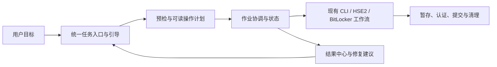

# HSE2 Roadmap 6.0

> **状态：**已制定，尚未开始实施。路线图 6.0 是开发顺序和验收合同，不是产品版本号、稳定版承诺或发布时间表。

## 目标

把当前已经具备丰富加密、归档、恢复、批处理和 Windows 交付能力的工具，推进为一套**新手能循序完成、熟练用户能高效操作、敏感操作结果可预测**的本地加密工作台。6.0 的“大更新”主要落在产品体验和工作流治理：整合现有入口、提供任务向导和统一作业状态、强化恢复前预览与错误修复指引，并用可重复的规模基准保护已有核心能力。

本路线图不以增加密码学算法或归档格式数量作为“大更新”的代理指标。密码学核心保持稳定，先让已有功能更容易找到、更容易正确使用、更容易确认结果。

## 制定依据与基线

- 当前产品版本为 v0.8.4；`master` 与 `origin/master` 同步，制定基线提交为 `b1503d4`。
- 路线图 5.0 阶段 0–5 已结项。v5 仍是实验性双视图格式，不宣称可否认性、抗胁迫或安全擦除；新建格式默认仍为 v2。
- 项目已有主 GUI、HSE2 独立/嵌入式 GUI、快速开始向导、CLI 及多个专题 CLI 入口。已有新手教程、术语表和发布版 Windows EXE；6.0 应复用现有领域工作流，不另造一套加密实现。
- 已有批量处理、归档校验/预览、逐文件暂存恢复、HSE2 v3 有界内存实现和 v5 打包回归。它们的现状与限制须先进入 6.0 能力矩阵，再决定改进点；不能把既有能力误报成缺失。
- Windows/BitLocker/DPAPI 是重要现有路径。首个 6.0 主交付继续以 Windows 发行包为准；跨平台 GUI、自动更新、安装器和签名证书不列入本轮硬门槛。
- 版本 5.0 的路线图、v5 成熟度决策及 v0.8.4 公开资产复核分别见同目录文档。

## 完成后的使用体验

1. 新手从一个清晰入口选择“加密文件/文件夹、打开或恢复归档、检查归档、管理密钥/恢复信息、BitLocker 设备”等任务；无需先理解 CLI 子命令、容器版本或内部模块名。
2. 每个关键输入旁有简明解释和“为什么需要”；高级参数仍可展开查看，安全默认值和当前选择的影响在执行前可见。
3. 长操作在统一作业区域显示阶段、进度、目标位置、结果和下一步建议。取消操作会说明已完成与未完成项，不会伪装成完整回滚。
4. 恢复或覆盖前先展示计划、目标路径、冲突与空间检查；结果报告明确指出哪些文件完成、跳过或失败，以及如何安全重试。
5. 新手可按教程完成核心任务；熟练用户仍可直接使用现有 CLI 和高级 GUI 工作流。格式兼容、密码来源和版本限制都有可查说明。

## 不在范围内

- 不设计或宣称真正的可否认性、隐藏卷、抗胁迫、安全擦除或取证不可见。
- 不在没有单独格式决策和完整兼容计划时改变默认容器格式、重解释旧格式或自动改写归档。
- 不因界面升级重写密码学核心，不引入自制密码原语。
- 不默认保存密码、恢复口令、密钥文件内容、明文路径历史或解密内容；不做自动续跑或自动覆盖。
- 不把 macOS/Linux GUI、在线账户同步、云备份、静默更新、付费签名证书、第三方审核/认证设为本路线图的完成条件。

## 实施原则

1. **领域逻辑复用：**GUI 与 CLI 调用既有工作流；新模块的接口小而清楚，复杂行为集中在稳定的模块内部。
2. **先计划后提交：**破坏性或覆盖操作都先生成可读计划，并要求用户明确确认；取消和错误保留源数据。
3. **可观测但不泄密：**状态和错误报告足以诊断，不记录秘密、明文内容或完整凭据参数。
4. **阶段门禁：**每阶段先完成文档和源码测试，再执行 GUI/EXE 验收。没有所需证据时标为待验证，不用文档代替运行验证。
5. **兼容优先：**所有既有归档版本继续按现有规则读取；界面和作业层升级不得隐式改变格式行为。

## 阶段与验收

| 阶段 | 状态 | 优先级 | 主题 | 依赖 | 完成标准 |
|---|---|---|---|---|---|
| 0 | [x] | P0 | 6.0 基线和产品合同 | 无 | 已盘点主 GUI、快速开始、HSE2 GUI、CLI、归档/恢复、BitLocker 和 Windows 发布路径；记录现有入口分散、向导偏演示型、缺少统一作业状态呈现等可从代码确认的差距；已冻结成功指标、错误语义、兼容性与数据保留规则。详见 [阶段 0 基线](20261114-hse2-roadmap-6.0-phase0-baseline.md)。 |
| 1 | [ ] | P0 | 统一任务工作台 | 阶段 0 | 设计并实现统一任务入口与一致导航，按用户目标组织现有能力；保持现有 CLI 和高级入口可用。能力矩阵中每个既有功能都有对应入口或明确的高级入口；无重复加密/归档业务逻辑；旧 GUI 主入口仍可启动。 |
| 2 | [ ] | P0 | 新手引导与术语解释 | 阶段 0、1 | 首次使用路径覆盖常见加密、解密/恢复、校验和密钥/恢复信息管理。每个高风险选项解释含义、用途、密码来源、输出位置及失败后果；高级设置可展开；教程步骤与实际 GUI 文案一致。自用走查完成后，核心任务都能说明输入、输出和所需凭据，且没有未说明的破坏性动作。 |
| 3 | [ ] | P1 | 统一作业队列和结果中心 | 阶段 1 | 对盘点确认可安全排队的操作提供统一状态模型：queued → running → cancelling → cancelled / succeeded / partial / failed。显示阶段进度、当前项目、目标和逐项结果；取消只在定义好的安全点生效；源文件不因失败或取消被删除；失败可针对失败项重试。默认不跨重启恢复作业，不持久化凭据或明文任务参数。 |
| 4 | [ ] | P0 | 恢复前计划与故障恢复体验 | 阶段 0、1 | 对恢复、替换、批量输出等适用操作，在写出前展示路径、文件数、命名冲突、覆盖策略和可检测的空间不足。复用现有校验、预览和 staging；明确每文件提交语义，不宣称整个目录事务性回滚。磁盘满、权限不足、路径冲突、认证失败、取消及进程中断均有可读结果和可执行的恢复建议。 |
| 5 | [ ] | P1 | 大任务基准和性能治理 | 阶段 0 | 为主要格式/操作建立固定、可复跑的样本矩阵，记录吞吐、峰值内存、临时磁盘占用和取消清理行为；明确哪些旧格式不保证有界内存。只有基准指出可重复瓶颈时才优化。优化不得破坏兼容夹具、固定向量、认证失败语义或逐文件恢复安全。 |
| 6 | [ ] | P0 | 发布验收与路线图结项 | 阶段 1–5 | 全量测试、秘密扫描、依赖审计、CLI/GUI smoke、Windows 打包工作流及下载资产摘要核验通过；安装包中教程/帮助资源可用；自用教程走查完成。汇总实际提交、测试、包摘要、已知限制和残余项目，再判断 6.0 完成与否；不自动改版本成熟度或公开发布。 |

## 设计蓝图

GUI 是现有领域工作流的适配层。作业协调负责调度、取消边界和结果呈现，不复制加密、格式解析或恢复代码。阶段 0 必须核实当前调用链，再冻结具体模块接口。

## 候选文件变更清单（未来阶段，当前未修改）

- `[MODIFY]` `src/high_security_encryptor/gui.py`：主 GUI 入口、任务导航和状态呈现；保持既有工作流调用。
- `[MODIFY]` `src/high_security_encryptor/hse2_quickstart_gui_tab.py`、`hse2_quickstart_wizard.py`：整合当前快速开始路径，避免重复向导。
- `[MODIFY]` `src/high_security_encryptor/hse2_gui_tab.py`、`hse2_gui_actions.py`：对齐 HSE2 任务入口、预检和结果语义。
- `[NEW，阶段 0 评审后决定]` `src/high_security_encryptor/job_controller.py`：若现有后台任务实现不足，再增加统一作业状态与安全取消协调；不能未盘点就先造新层。
- `[MODIFY]` `docs/beginner/`、`docs/beginner_gui_usage.md`：让教程与实际任务界面逐项对应，维护术语、输入输出及恢复说明。
- `[MODIFY]` `tests/test_gui*`、`tests/test_hse2*`、`.github/workflows/windows-exe.yml`：覆盖新界面、作业状态/取消、失败清理及最终 Windows 包。

以上是规划用候选清单，不是已冻结的逐文件设计；阶段 0 需检查调用关系后确认、拆分或删除候选项。

## 概念与风险审查

### 关键取舍

- **工作台不等于重写核心。**项目已有多个 UI、CLI 和稳定领域工作流。保留这些路径可降低格式与加密回归的风险；新体验通过复用调用链达成。
- **可取消不等于可恢复。**中断后安全清理比自动断点续跑更容易解释和验证。首轮只支持在安全检查点取消，作业状态不跨重启恢复。
- **进度必须真实。**只有工作流能可靠提供阶段/字节/项目计数时才显示百分比；未知时显示阶段和已处理数量，不估算虚假百分比。
- **性能优化由数据驱动。**已有 v3 有界内存路径，不应为视觉上的“大改”重复实现流式功能；先分格式测量，再决定具体优化。

### Red Team：需要主动防住的失败方式

1. **界面重复调用或重入导致并发写同一路径。**为输出目标加作业级冲突检查；执行中拒绝危险的重复计划；提交前再次检查目标变化。
2. **取消发生在加密/解密提交边界，留下半成品或误报成功。**明确每个工作流的取消点；输出使用同目录 staging，认证/校验和文件关闭后才提交；取消测试检查源文件、目标文件和临时文件。
3. **日志、作业历史或错误上下文泄露密码、恢复口令、DPAPI 输入或敏感路径。**作业结果使用结构化字段与显式白名单；凭据不进任务持久化；秘密扫描和特征化日志测试作为门禁。
4. **恢复计划过期。**计划和提交之间文件系统可能改变；执行前重新核验冲突、输入身份和可用空间，必要时要求重新确认。
5. **老格式与新 GUI 版本行为不一致。**以 v2/v3/v4/v5 固定容器和 Windows 打包路径作兼容矩阵；入口只路由到现有格式 dispatch，不推断、不迁移格式。
6. **单体 GUI 再次膨胀。**阶段 0 画真实调用图；只有存在两个真实适配器/行为变化点时才新增 seam；通过模块接口测试限制内部复杂度。

## 验证协议

- **能力覆盖：**依据阶段 0 能力矩阵，对每个用户可见操作有 GUI/CLI 对应入口、确认要求、成功结果和失败解释的测试或人工验收。
- **作业状态：**测试每条合法状态转移、重复取消、失败后重试、窗口关闭、重复目标和多个后台任务；终态唯一，任务不能静默重入。
- **数据安全：**覆盖认证失败前不落恢复明文、失败时 staging 清理、取消时源保留、覆盖确认、权限/空间/路径错误以及秘密不落日志/本地历史。
- **兼容：**v2/v3/v4/v5 固定夹具在源码和打包版中按既有规则读写；本路线图不以更改默认格式作为验收项。
- **可用性：**用随包新手教程对加密、恢复、校验、BitLocker/密钥管理等代表任务做端到端走查；记录每步实际文案、用户需要的术语解释、是否有错误路径和最终输出。不能仅以教程文件存在判定通过。
- **性能：**固定硬件/运行时和样本，重复基准并保存原始命令、提交、样本摘要及峰值内存。不得把一次机器的结果泛化成所有环境保证。
- **发布：**执行现有 Windows EXE workflow；公开发布若发生，独立下载核验资产摘要、清单、教程和 smoke 结果。

## 回滚与失败遏制

- 每阶段按独立提交交付，先保留现有 GUI/CLI 入口；统一工作台不通过时可回退到旧入口，归档文件不需要迁移。
- 新作业状态不保存秘密，不自动续跑。回滚作业层不会改变归档格式或遗留待解密数据。
- 所有输出先写入目标目录的临时文件/目录；仅在验证完成后提交。回滚时保留源，报告并定位清理未提交临时文件的规则。
- 若任务队列、界面整合或规模优化影响格式读写、凭据边界或数据安全，暂停对应阶段，恢复最后一个通过全量兼容门禁的提交；不要用关闭校验或静默降级来规避失败。

## 当前结论

阶段 0 已完成，阶段 1 尚未开始。下一项是统一任务入口的界面/调用图设计；先复用现有 GUI 标签和 HSE2 工作流，确认导航与启动行为后再做最小纵向实现。
